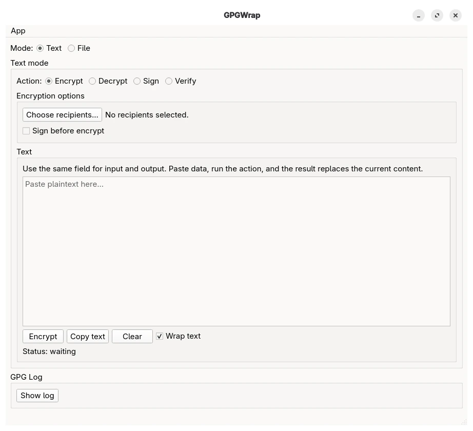

# GPGWrap

GPGWrap is a lightweight Linux desktop GUI for common OpenPGP tasks using the system `gpg` binary.

It provides a simple interface for encrypting, decrypting, signing, and verifying text or files, plus basic key management and key generation.



## Features

### Text mode
- Encrypt text
- Decrypt text
- Sign text
- Verify clear-signed text
- Verify detached signatures

### File mode
- Encrypt files
- Decrypt files
- Sign files
- Verify file signatures

### Key management
- Import keys from file
- Import armored keys directly from clipboard
- Export public keys
- Copy public key to clipboard
- Delete keys
- Generate new keys
- Sign public keys (local or exportable) after fingerprint verification
- Set ownertrust independently of key signing

### Operation controls
- Responsive GPG operations with a cancel button
- Confirmation before replacing existing output files
- Automatic main-window decorations: standard on GNOME/KDE, hidden on Sway/Hyprland

## Requirements

- Linux desktop environment
- Python 3.10+
- `gpg`
- `gpg-agent`
- `pinentry`

## Install with pipx

```bash
pipx install gpgwrap
```

Install directly from GitHub:

```bash
pipx install git+https://github.com/h0ek/gpgwrap.git
```

## Run
```bash
gpgwrap
```

## Keyboard shortcuts

- `Ctrl+E` — switch to Encrypt and run the action in the current mode
- `Ctrl+D` — switch to Decrypt and run the action in the current mode

## Install desktop launcher and icon

After installation, you can install the desktop entry and icon for the current user:
```bash
gpgwrap-install-desktop
```
After that, GPGWrap should appear in your application menu.

## Notes
- GPGWrap uses the system GnuPG installation.
- Your keys remain managed by your local GPG setup.
- The application is intended for desktop Linux use.
- Decryption and signature verification are reported separately. Successfully decrypted content can be shown or saved with an explicit signature warning; failed integrity checks discard the output.
- Text mode uses UTF-8 and preserves leading/trailing whitespace. Use File mode for binary data or byte-exact file signatures.
- Output files are written through a private temporary file. The input file and its links cannot be used as output, and existing output files are only replaced after a successful operation.
- Message contents are excluded from the GPG log. Clear fields also clears the log.
- Cancellation stops GPG; keyring changes already made are retained.
- Set `GPGWRAP_DECORATIONS=on` or `GPGWRAP_DECORATIONS=off` to override automatic main-window decorations.

## Upgrade

```bash
pipx upgrade gpgwrap
```

If you installed GPGWrap from GitHub, you may need to force reinstall to get the latest version:

```bash
pipx install --force git+https://github.com/h0ek/gpgwrap.git
```

## Uninstall

Remove the application:

```bash
pipx uninstall gpgwrap
```

Remove desktop entry and icon (optional):

```bash
rm ~/.local/share/applications/gpgwrap.desktop
rm ~/.local/share/icons/hicolor/256x256/apps/gpgwrap.png
```
